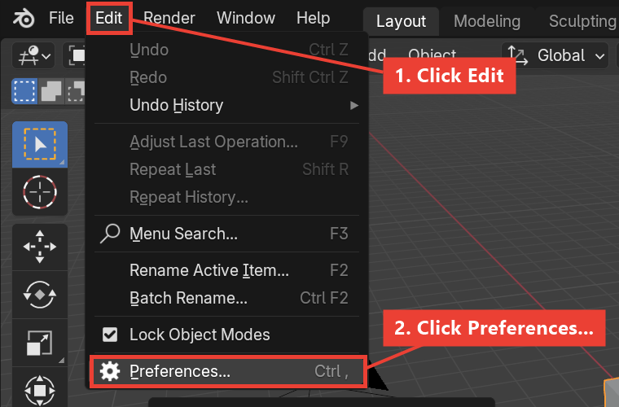
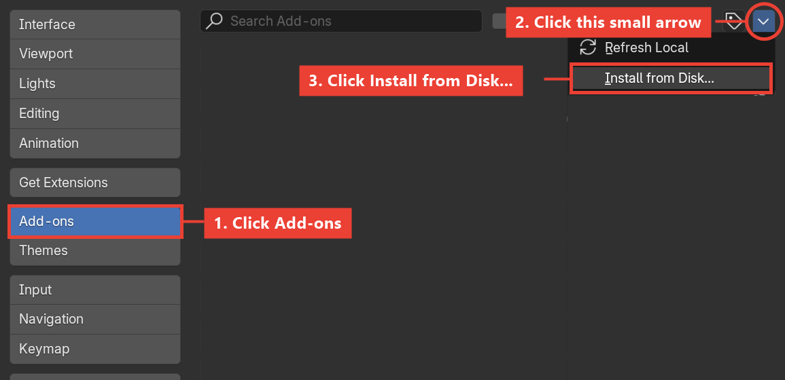
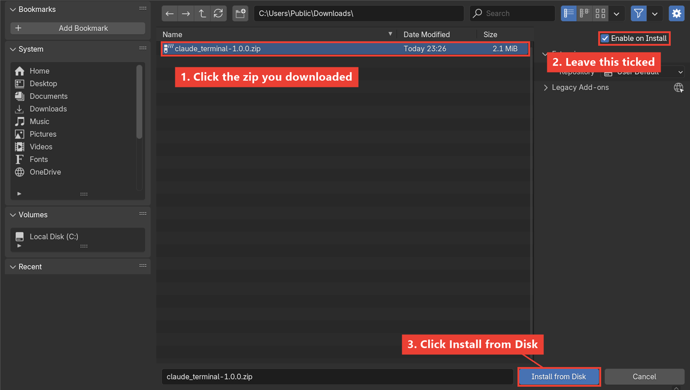
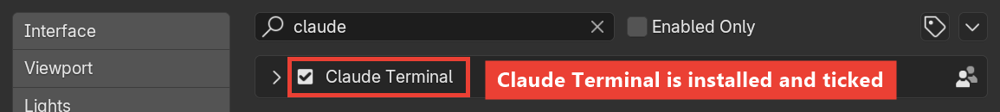
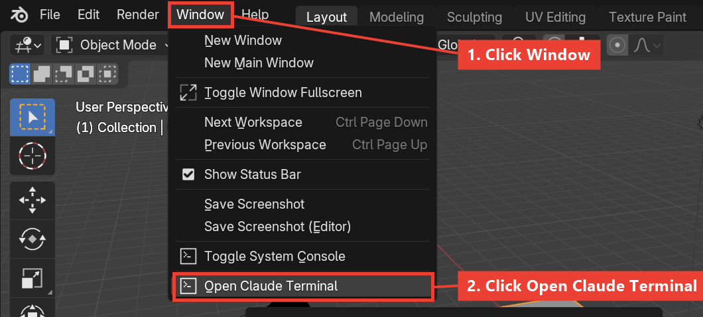
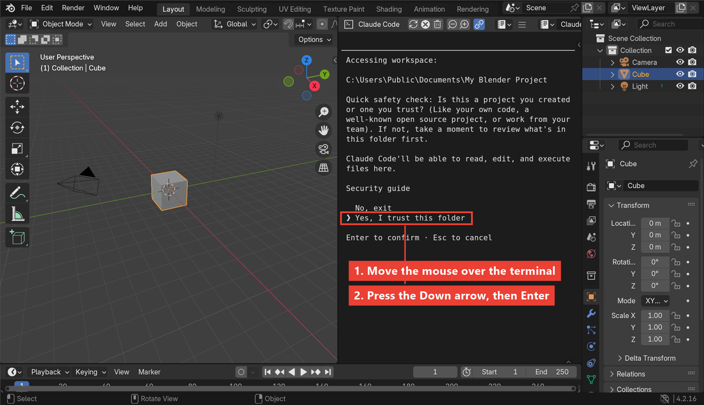
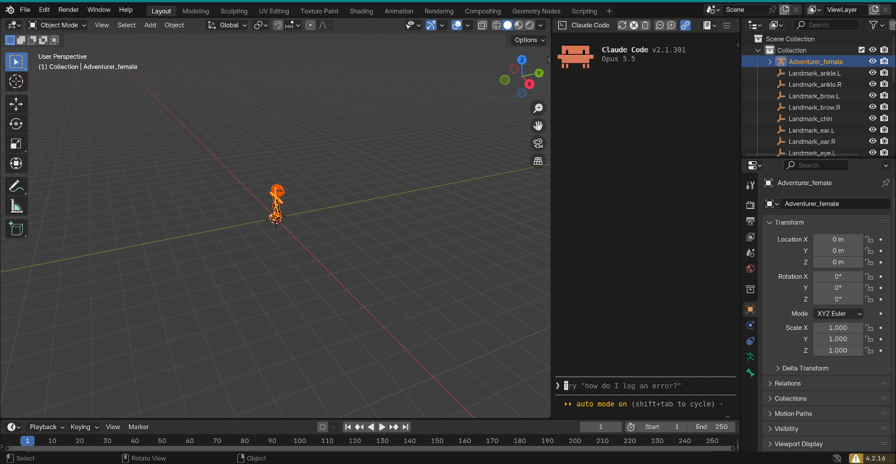

# Install Claude Terminal, step by step

About 5 minutes, no coding. Every step has a picture.

> **Prefer to have Claude do it?** See [Let Claude install it for you](INSTALL_WITH_CLAUDE.md).

## Before you start

You need two things:

1. **Blender 4.2 or newer, on Windows.** Get it from [blender.org](https://www.blender.org/download/).
2. **Claude Code, signed in.** To check: open the Start menu, type **PowerShell**,
   open it, type `claude` and press Enter.
   - If Claude's welcome screen appears, you're ready. Type `/exit` and press Enter to close it.
   - If it says *"not recognized"*, install Claude Code first:
     [Claude Code setup guide](https://code.claude.com/docs/en/setup).

## Step 1: Download the add-on

1. Open the [latest release page](https://github.com/raising-heart/blender-mcp-terminal/releases/latest).
2. Under **Assets**, click **claude_terminal-1.0.0.zip**. It goes to your **Downloads** folder.
3. **Don't unzip it.** Blender needs the .zip file as it is.

## Step 2: Open Blender's Preferences

Open Blender, click **Edit** at the top, then **Preferences...**

## Step 3: Choose "Install from Disk"

In the Preferences window, click **Add-ons** on the left, then the small **arrow**
at the top right, then **Install from Disk...**

## Step 4: Pick the zip

A file window opens. Click **Downloads** on the left, click
**claude_terminal-1.0.0.zip**, and leave **Enable on Install** ticked. Then click
**Install from Disk**.

## Step 5: Check it worked

Type **claude** in the search box at the top of the Add-ons list.
**Claude Terminal** should be there with a tick. Then close the Preferences window.

## Step 6: Open the terminal

Click **Window** at the top, then **Open Claude Terminal**.

## Step 7: Say yes to the safety question (first time only)

A dark panel opens to the right of the 3D view. That's the terminal.
Claude asks if you trust the folder. **Move your mouse over the terminal**, press
the **Down arrow** once so "Yes, I trust this folder" is selected, then press **Enter**.

## Done!

Type what you want and press Enter. For example:

> Add a low-poly tree next to the cube, then take a screenshot to check it.

Claude builds it in the 3D view while you watch. Press **Ctrl+Z** to undo a change.

Next time, just open Blender and click **Window > Open Claude Terminal**.

## Something not right?

| What you see | What to do |
| --- | --- |
| No **Open Claude Terminal** in the Window menu | Do Step 5. If Claude Terminal isn't in the list, repeat Steps 2 to 4. |
| Typing does nothing | Move the mouse over the terminal first. Keys go to whatever is under the mouse. |
| *"claude is not recognized"* in the terminal | Install Claude Code (see *Before you start*), then click the **circular arrow** button at the top of the terminal. |
| Pressed Enter too early and Claude closed | Click the **circular arrow** button at the top of the terminal to start it again. |
| Claude says it can't reach Blender | Click the **circular arrow** button at the top of the terminal. |
| Text too small or too big | Hold **Ctrl** and turn the mouse wheel over the terminal. |
